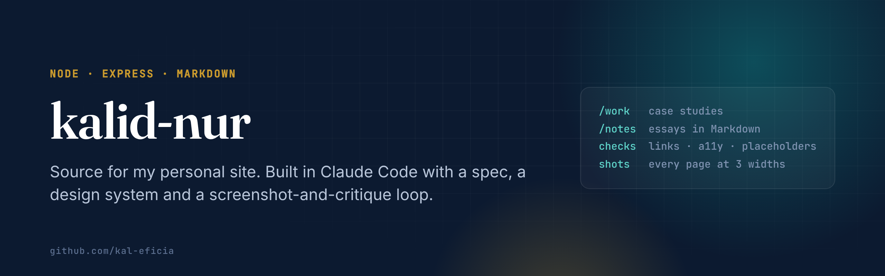

<p align="center"></p>

<p align="center">
  
  
  
</p>

The source for my personal site: *I find the gap. Then I build the fix.*

It's a small, fast, server-rendered site with no frontend framework. Pages are plain template functions, case studies and notes are Markdown files, and a set of scripts keeps quality honest: screenshots of every page at three widths, automated checks, Lighthouse and generated social cards.

Client case studies and media aren't in this public copy. Six of my own projects are included as example content.

## Structure

```
server/
  index.js        routes, security headers, rate limits
  config.js       the handful of values that change by hand (links, booking URL)
  content.js      loads and validates content/ (fails loudly on a broken file)
  views/          one module per page: home, work, notes, layout
content/
  work/           one Markdown file per project (title, type, tags, case study or card)
  essays/         notes, published with `published: true`
public/           brand assets, CSS, small JS, social cards
scripts/          shots, checks, Lighthouse, OG image generation
docs/             the spec, design system and copy the site was built from
```

## Run it

```bash
npm install
npx playwright install chromium   # once, for screenshots and checks
npm run dev                       # http://localhost:3000
```

| Command | What it does |
|---|---|
| `npm run shots` | Screenshots every page at 1440, 768 and 390 into `shots/` |
| `npm run checks` | Links, headings, alt text, placeholders, metadata |
| `npm run checks:prod` | Same, and fails on any unfilled placeholder |
| `npm run lighthouse` | Mobile Lighthouse on every page |
| `npm run og` | Regenerates the social cards |

## How it was built

Built in **Claude Code** from a locked spec (`docs/rebrand/SPEC.md`), design system (`DESIGN.md`) and word-for-word copy (`CONTENT.md`). After every change, a `ui-critic` subagent reviews fresh screenshots and the fixes go in before the next step. The loop is documented in `docs/UX-REVIEW.md`.

---

[Kalid Nur](https://github.com/kal-eficia) · AI builder and teacher · founder of [eficiatech](https://eficiatech.com)
